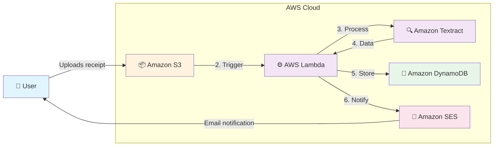

# Automated AWS Receipt Processing System

<!-- Row 1: Status - Most Important -->
[](https://github.com/subhamay-bhattacharyya/aws-receipt-processing-system/releases)&nbsp;[](https://github.com/subhamay-bhattacharyya/aws-receipt-processing-system/actions/workflows/release.yaml)&nbsp;[](https://github.com/subhamay-bhattacharyya/aws-receipt-processing-system/issues)&nbsp;[](https://github.com/subhamay-bhattacharyya/aws-receipt-processing-system/commits)

<!-- Row 2: Code Quality -->
[](https://github.com/subhamay-bhattacharyya/aws-receipt-processing-system)&nbsp;[](https://github.com/subhamay-bhattacharyya/aws-receipt-processing-system/commits)

<!-- Row 3: Tech Stack -->
[](https://aws.amazon.com/cloudformation/)&nbsp;[](https://claude.ai/)

<!-- Row 4: Repository Info -->
[](https://github.com/subhamay-bhattacharyya/aws-receipt-processing-system)&nbsp;[](https://github.com/subhamay-bhattacharyya/aws-receipt-processing-system)&nbsp;[](https://github.com/subhamay-bhattacharyya/aws-receipt-processing-system/releases)

<!-- Row 5: Custom Metrics -->
[](https://gist.github.com/subhamay-bhattacharyya/468a63b8b6c664f86c2629edb0f4a282)

---

## Overview

An automated receipt processing pipeline that ingests receipt images/PDFs, extracts structured data using ML, and stores results with email notifications. Built entirely with Infrastructure-as-Code using CloudFormation nested stacks for modularity and reusability across environments.

---

## Architecture



### Steps

1. The user uploads a receipt to S3.
2. The S3 upload triggers the Lambda function.
3. Lambda invokes Amazon Textract to extract data from the receipt.
4. Textract returns structured data to Lambda.
5. Lambda stores the processed data in the DynamoDB table.
6. Lambda uses Amazon SES to send an email notification to the user.

---

## Features & Status

| Component | Purpose | Status |
| --- | --- | --- |
| **S3 Bucket** | Stores receipt images/PDFs with versioning & encryption | ✅ Complete |
| **DynamoDB Table** | Stores extracted receipt metadata | ✅ Complete |
| **Lambda Function** | Orchestrates receipt processing workflow | ✅ Complete |
| **Textract Integration** | Extracts text/data from receipts | ✅ Complete |
| **SES Notifications** | Sends email with extracted details | ✅ Complete |
| **IAM Roles & Policies** | Cross-service permissions | ✅ Complete |

---

## Project Structure

``` text
.
├── .claude/
│   └── .skills/                     # Custom skills (contribution, github-ci-workflow, package-json, readme-md)
├── .devcontainer/
│   └── devcontainer.json            # Dev container setup
├── .env/
│   └── environments.yaml            # Environment configuration
├── .github/
│   ├── workflows/
│   │   ├── ci.yaml                  # Template validation & deployment
│   │   ├── claude.yaml              # Claude Code integration
│   │   ├── claude-code-review.yaml  # Claude Code review
│   │   ├── create-branch.yaml       # Issue-based branch automation
│   │   ├── deploy.yaml              # CloudFormation stack deployment
│   │   ├── deploy-lambda.yaml       # Lambda build and deployment
│   │   ├── delete.yaml              # CloudFormation stack deletion
│   │   ├── notify.yaml              # Slack notifications
│   │   └── setup-environments.yaml  # AWS environment setup
│   ├── ISSUE_TEMPLATE/              # Bug report and feature request templates
│   ├── CODEOWNERS                   # Repository ownership
│   ├── dependabot.yaml              # Dependency updates
│   └── PULL_REQUEST_TEMPLATE.md     # PR template
├── cloudformation/
│   ├── template.yaml                # Root CloudFormation stack
│   ├── parameters.json              # Stack parameters
│   └── stack-config.json            # Stack configuration
├── lambda/
│   └── receipt-processor/
│       ├── lambda.py                # Lambda handler
│       ├── requirements.txt         # Python dependencies
│       └── structured_logging/      # Structured logging package
├── scripts/
│   └── plugins/                     # Semantic-release plugins
├── .gitattributes                   # Git attribute settings
├── .gitignore                       # Git ignore rules
├── CLAUDE.md                        # Project guidelines
├── CONTRIBUTING.md                  # Contribution guidelines
├── CHANGELOG.md                     # Version history
├── PROGRESS.md                      # Implementation tracking
├── CODE_OF_CONDUCT.md               # Code of conduct
├── LICENSE                          # MIT License
└── README.md                        # This file
```

---

## Key Features

### Infrastructure as Code

- Nested CloudFormation stack pattern for modularity
- Parameter-driven multi-environment configuration
- Deterministic resource naming (ProjectName-Environment-AccountId-Region)

### Security Best Practices

- S3 versioning and public access blocking
- KMS encryption for S3 and DynamoDB
- DynamoDB point-in-time recovery
- IAM least-privilege access patterns

### CI/CD & Automation

- GitHub Actions validation and deployment
- AWS OIDC keyless authentication
- Semantic versioning with conventional commits
- Automated CloudFormation template validation

---

## Next Steps

1. Create Lambda function CloudFormation template
2. Integrate Amazon Textract for OCR
3. Configure SES for email notifications
4. Define IAM roles and cross-service policies
5. Set up DynamoDB Streams to Lambda integration

---

## Contributing

See [CONTRIBUTING.md](CONTRIBUTING.md) for guidelines.

---

## License

MIT
